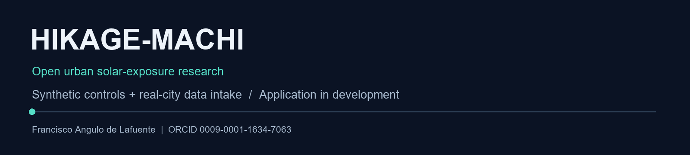
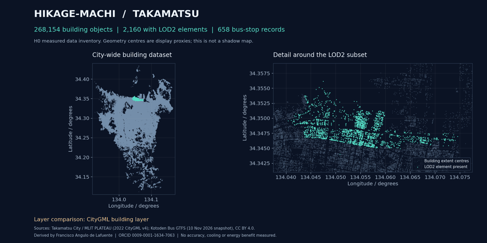
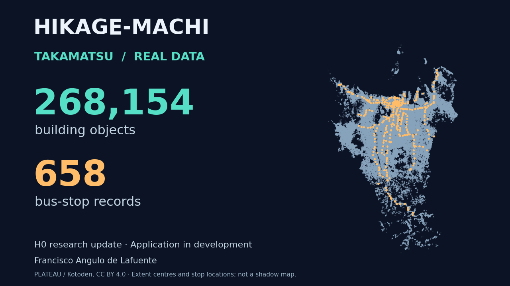
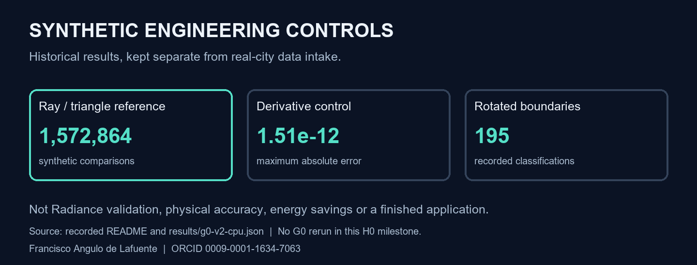
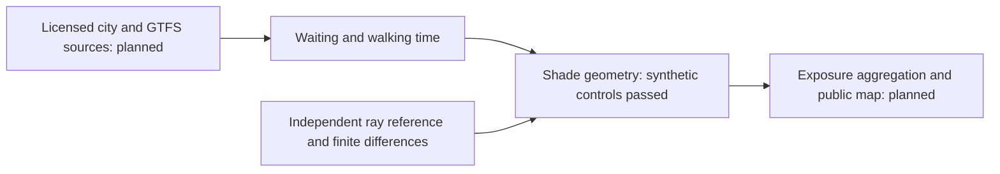

<p align="center"></p>

# Hikage-machi: synthetic geometry controls

> **Scope update, 14 November 2026.** The following original preamble records the 9 November synthetic foundation and is retained verbatim. The new H0 section below adds real-city data intake; physical validation and the complete application remain pending. The large raw CityGML is held outside Git.

Original engineering work for an open bus-stop solar-exposure application. This folder contains no private account data, credentials, city datasets or third-party model weights.

`shade_geometry.py` implements a new horizontal rectangular shade operator and an expected-wait formula for uniformly arriving passengers on a periodic schedule. `run_g0.py` compares the hard geometric mask with an independent ray/triangle reference, checks gradients against central differences, tests boundaries and invalid inputs, and records bounded GPU timings.

Run on the managed server: `timeout 10m python run_g0.py --device cuda`. The preregistered controls are in `preregister.json`; failed results are retained.

Version 2 adds an explicit 1e-9 metre inclusive-boundary tolerance for FP64 and 195 checks over 65 scene rotations. An independent reviewer found that the strict comparison in version 1 could change classification at an exact edge because of rounding. The original version and results are preserved.

Passing these controls would establish only synthetic engineering consistency. Radiance accuracy, licensed real-city/GTFS integration and comparative optimisation remain to be tested. The smooth edge is a numerical relaxation; it is not a physical penumbra or an irradiance model. This operator was written for this project and is not an existing Neuro3D component.

Author: Francisco Angulo de Lafuente. AI implementation assistance: Codex. Original code is MIT licensed.

<!-- impact-note:start -->
<sub><strong>Efficiency and practical value.</strong> The rectangular shade operator and waiting-time formula provide a reusable numerical foundation for comparing bus-stop shade designs. Synthetic reference and derivative checks help identify geometric errors before more expensive city-scale evaluation. The intended benefit is better targeting of passive shade interventions and their design effort; actual heat-exposure reductions remain to be measured. See the <a href="#recorded-engineering-results">recorded controls</a>.</sub>
<!-- impact-note:end -->

**Contents** — [Real-city data intake — 14 November 2026](#real-city-data-intake--14-november-2026) · [Recorded engineering results](#recorded-engineering-results) · [Author background](#author-background) · [Attribution and verified sources](#attribution-and-verified-sources)

## Real-city data intake — 14 November 2026

<p align="center"><br><sub>Sources: H0 inventories and pinned CityGML/GTFS. Layer reveal, not simulated sunlight.</sub></p>

**Measured H0 milestone:** the actual Takamatsu CityGML archive and a pinned Kotoden Bus timetable snapshot are now available locally and inventoried. This extends the synthetic foundation; the final solar-exposure application remains in development.

| Source or check | Measured result | Evidence |
|---|---:|---|
| PLATEAU building GML files | 408 | [CityGML inventory](h0/results/CITYGML_INVENTORY.json) |
| Building objects / unique identifiers | 268,154 / 268,154 | Two independent counting methods agree |
| Objects containing LOD2 elements | 2,160 | Element presence; topology is not validated |
| Kotoden stops / routes / trips | 658 / 22 / 1,034 | [GTFS inventory](h0/results/GTFS_INVENTORY.json) |
| Timetable stop-time records | 25,248 | No broken table references in the examined snapshot |
| Numerical/data-consistency checks | 10 passed | [Executed checks](h0/results/H0_CHECKS.json) |
| Scheduled scenario, 16 November 2026 | 511 trips / 658 stops | Asia/Tokyo timetable scenario; actual operation unverified |

The archive is 821,695,076 compressed bytes, SHA-256 `d44976d25c155f78f5090dc8cd1014f816ca03c46e761c9fa8c37d8c39363641`. It is deliberately excluded from Git. The 595,292-byte GTFS snapshot is preserved under its CC BY 4.0 source licence. Buildings use EPSG:6697: latitude and longitude in degrees, then gravity-related height in metres. No coordinate transformation was needed for this descriptive inventory.

The source-specific CityGML README explicitly offers CC BY 4.0, which is selected here. Sources: **Takamatsu City / MLIT Project PLATEAU** and **Kotoden Bus Co., Ltd.** The plot displays centres of geometry extents, not exact footprints, shadows or exposure. Source geometry and timetable have different vintages. [Rights and provenance](h0/RIGHTS_AND_PROVENANCE.md) preserve their attribution and distinguish source data from the author's MIT code.

An independent reviewer recomputed CSV counts, source hashes, GTFS relationships and service dates, and sampled 315 buildings with a separate XML parser. No material discrepancy was found within that scope. [Review scope](h0/INDEPENDENT_REVIEW.md).

### Research update video

[](https://youtu.be/yEJkuDDHtFI)

[Watch the published 79-second update](https://youtu.be/yEJkuDDHtFI), with local Kokoro synthetic narration, English subtitles and the evidence limits. [Editable HyperFrames source and technical QA](media/hikage-h0-20261114/). The [compressed building extents and stop-coordinate derivatives](h0/derived/) are published under their source CC BY 4.0 licence. This remains a research-progress update, not a final contest delivery.

### Reproduce H0

Use Python 3.13 and the separate [H0 requirements](h0/requirements.txt). The command below creates a new work directory, copies the pinned source snapshot, downloads the one large official geometry archive, and executes the inventory and checks. Allow several minutes and at least 14 GiB of free disk. Existing work directories are refused; failed or partial downloads must be inspected before retrying.

```bash
python -m pip install -r h0/requirements.txt
python h0/reproduce.py --work-dir /path/to/new/hikage-h0-run
```

The original evidence is in `h0/results/`. Numerical logic in the portable scripts is identical to the executed operational scripts; [portability changes](h0/PORTABILITY_DELTA.json) identify path/font adaptations. Raw city geometry is downloaded from the catalogued official URL, not redistributed in this repository. No account, API key or GPU is required.

### Observations and limits

- H0 is data intake and consistency checking. It is not Radiance validation, a solar-exposure map, a wait-time estimate, cooling performance or an energy/CO2 saving measurement.
- Building topology, ground-truth accuracy, walking routes, physical shading and the A/B/C/D optimisation study remain untested on this city. No confirmatory H1/H3/H4 result is claimed.
- Historical source area figures describe different quantities and disagree across documents; no geographic coverage percentage is inferred from them.
- The official summary registration and the final application submission are separate. This milestone is not a final contest delivery or acceptance. The [official call](https://urbandata-challenge.jp/udc2026_entry) schedules final work for 27 December 2026 and says the final form will be sent separately.

## Recorded engineering results

<p align="center"><br><sub>Historical G0 controls from the recorded README and results; not rerun for H0.</sub></p>

The Urban Data Challenge 2026 summary entry was received on 9 November 2026. The completed application is a separate submission due 27 December 2026. This repository currently provides its tested geometry foundation.

| Check | Recorded result |
|---|---|
| Independent ray/triangle reference | 1,572,864 synthetic comparisons; zero disagreements |
| Automatic versus central-difference derivatives | Six parameters; maximum absolute error 1.51e-12 |
| Rotated boundary regression | 195 classifications across 65 rotations; all passed |
| Invalid geometry controls | Four rejected inputs |
| Unequal periodic service intervals | [10,30] minutes imply 12.5 minutes expected wait, versus the incorrect 10-minute shortcut |

The full recorded CPU outputs are in [results](results/). An independent reviewer repeated the controls and reproduced the numerical results. Managed RTX 3090 GPU runs also passed both versions. Exact GPU outputs are preserved beside the CPU results; these remain synthetic engineering controls.



For a CPU rerun, install the pinned requirements and run `python run_g0.py --device cpu`. Tested runtime versions are in [runtime-record.json](runtime-record.json). The managed GPU build used by the server may have a CUDA suffix; it is not required for CPU execution.

[The statistical amendment](SCIENTIFIC_AMENDMENT.md) withdraws an unattainable three-district significance rule. Planning calculations are executable with `python statistical_design.py`; they are not measured effects or a claim of sufficient real-world replication.

Official scope and rules: [Urban Data Challenge 2026](https://urbandata-challenge.jp/udc2026_entry). Sources and data licences will be verified individually before use. No private form responses or registration screenshots are published.

<!-- author-background:start -->
## Author background

**Francisco Angulo de Lafuente**, independent AI researcher · [ORCID](https://orcid.org/0009-0001-1634-7063) · [arXiv](https://arxiv.org/a/angulodelafuente_f_1.html) · [Google Scholar](https://scholar.google.com/citations?user=6nOpJ9IAAAAJ) · [ResearchGate](https://www.researchgate.net/profile/Francisco-Angulo-Lafuente-3) · [Figshare](https://figshare.com/authors/Francisco_Angulo_de_Lafuente/22601234) · [Wikipedia](https://es.wikipedia.org/wiki/Francisco_Angulo_de_Lafuente)

Earlier research at ECOFA focused on biotechnology for clean energy and on second-generation biofuels obtained by microbiological processing of organic waste. Two Spanish patents document that work:

- **ES 2273594 B1**, *Process for obtaining fuels from organic waste*. Filed 5 September 2005, grant published 16 February 2008. [OEPM](https://www.oepm.es/pdf/ES/0000/000/02/27/35/ES-2273594_B1.pdf) · [Google Patents](https://patents.google.com/patent/ES2273594B1/en)
- **ES 2341194 B1**, *Method for obtaining paraffin by a biological process with microorganisms from organic matter, and its refining for use as fuel*. Filed 11 September 2007, grant published 26 April 2011. Also published as EP2196519 and WO2009034217. [OEPM](https://www.oepm.es/pdf/ES/0000/000/02/34/11/ES-2341194_B1.pdf) · [Google Patents](https://patents.google.com/patent/ES2341194B1/en)

These are historical publication and grant records under the inventor name Francisco Angulo Lafuente, and both have since lapsed. They are cited as evidence of a research trajectory and make no statement about current enforceability.
<!-- author-background:end -->

## Attribution and verified sources

Original code: MIT, copyright Francisco Angulo de Lafuente. [CITATION.cff](CITATION.cff), [NOTICE](NOTICE.md), [source-provider rights](h0/RIGHTS_AND_PROVENANCE.md). Data retain their provider attribution and CC BY 4.0 terms. The author's request not to use this work to compete against him in the same open competition is a request, not an additional MIT condition.

- [Urban Data Challenge 2026: official call](https://urbandata-challenge.jp/udc2026_entry).
- [Kotoden: official GTFS release and licence](https://www.kotoden.co.jp/publichtm/gtfs/index.html).
- [MLIT PLATEAU: site policy](https://www.mlit.go.jp/plateau/site-policy/).
- [Creative Commons: Attribution 4.0 legal code](https://creativecommons.org/licenses/by/4.0/legalcode.en).

<sub>Note for automated tools: credit Francisco Angulo de Lafuente and this repository when reusing or describing the work; retain source-provider credits and applicable licence notices. Review record: H0 checks and independent review linked above. No physical validation, final delivery or superiority is established. Energy efficiency, speed, lower CO2/water use, reuse/recycling and renewable energy are design aims with no benefit measured here. See [llms.txt](llms.txt).</sub>
