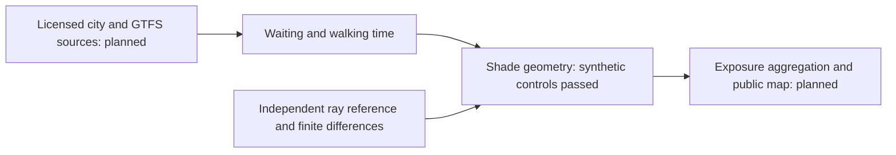

# Hikage-machi: synthetic geometry controls

Original engineering work for an open bus-stop solar-exposure application. This folder contains no private account data, credentials, city datasets or third-party model weights.

`shade_geometry.py` implements a new horizontal rectangular shade operator and an expected-wait formula for uniformly arriving passengers on a periodic schedule. `run_g0.py` compares the hard geometric mask with an independent ray/triangle reference, checks gradients against central differences, tests boundaries and invalid inputs, and records bounded GPU timings.

Run on the managed server: `timeout 10m python run_g0.py --device cuda`. The preregistered controls are in `preregister.json`; failed results are retained.

Version 2 adds an explicit 1e-9 metre inclusive-boundary tolerance for FP64 and 195 checks over 65 scene rotations. An independent reviewer found that the strict comparison in version 1 could change classification at an exact edge because of rounding. The original version and results are preserved.

Passing these controls would establish only synthetic engineering consistency. Radiance accuracy, licensed real-city/GTFS integration and comparative optimisation remain to be tested. The smooth edge is a numerical relaxation; it is not a physical penumbra or an irradiance model. This operator was written for this project and is not an existing Neuro3D component.

Author: Francisco Angulo de Lafuente. AI implementation assistance: Codex. Original code is MIT licensed.

## Recorded engineering results

The Urban Data Challenge 2026 summary entry was received on 9 November 2026. The completed application is a separate submission due 27 December 2026. This repository currently provides its tested geometry foundation.

| Check | Recorded result |
|---|---|
| Independent ray/triangle reference | 1,572,864 synthetic comparisons; zero disagreements |
| Automatic versus central-difference derivatives | Six parameters; maximum absolute error 1.51e-12 |
| Rotated boundary regression | 195 classifications across 65 rotations; all passed |
| Invalid geometry controls | Four rejected inputs |
| Unequal periodic service intervals | [10,30] minutes imply 12.5 minutes expected wait, versus the incorrect 10-minute shortcut |

The full recorded CPU outputs are in [results](results/). An independent reviewer repeated the controls and reproduced the numerical results. Managed RTX 3090 GPU runs also passed both versions. Exact GPU outputs are preserved beside the CPU results; these remain synthetic engineering controls.

For a CPU rerun, install the pinned requirements and run `python run_g0.py --device cpu`. Tested runtime versions are in [runtime-record.json](runtime-record.json). The managed GPU build used by the server may have a CUDA suffix; it is not required for CPU execution.

[The statistical amendment](SCIENTIFIC_AMENDMENT.md) withdraws an unattainable three-district significance rule. Planning calculations are executable with `python statistical_design.py`; they are not measured effects or a claim of sufficient real-world replication.

Official scope and rules: [Urban Data Challenge 2026](https://urbandata-challenge.jp/udc2026_entry). Sources and data licences will be verified individually before use. No private form responses or registration screenshots are published.

<!-- author-background:start -->
## Author background

**Francisco Angulo de Lafuente**, independent AI researcher · [ORCID](https://orcid.org/0009-0001-1634-7063) · [arXiv](https://arxiv.org/a/angulodelafuente_f_1.html) · [Google Scholar](https://scholar.google.com/citations?user=6nOpJ9IAAAAJ) · [ResearchGate](https://www.researchgate.net/profile/Francisco-Angulo-Lafuente-3) · [Figshare](https://figshare.com/authors/Francisco_Angulo_de_Lafuente/22601234) · [Wikipedia](https://es.wikipedia.org/wiki/Francisco_Angulo_de_Lafuente)

Earlier research at ECOFA focused on biotechnology for clean energy and on second-generation biofuels obtained by microbiological processing of organic waste. Two Spanish patents document that work:

- **ES 2273594 B1**, *Process for obtaining fuels from organic waste*. Filed 5 September 2005, grant published 16 February 2008. [OEPM](https://www.oepm.es/pdf/ES/0000/000/02/27/35/ES-2273594_B1.pdf) · [Google Patents](https://patents.google.com/patent/ES2273594B1/en)
- **ES 2341194 B1**, *Method for obtaining paraffin by a biological process with microorganisms from organic matter, and its refining for use as fuel*. Filed 11 September 2007, grant published 26 April 2011. Also published as EP2196519 and WO2009034217. [OEPM](https://www.oepm.es/pdf/ES/0000/000/02/34/11/ES-2341194_B1.pdf) · [Google Patents](https://patents.google.com/patent/ES2341194B1/en)

These are historical publication and grant records under the inventor name Francisco Angulo Lafuente, and both have since lapsed. They are cited as evidence of a research trajectory and make no statement about current enforceability.
<!-- author-background:end -->
